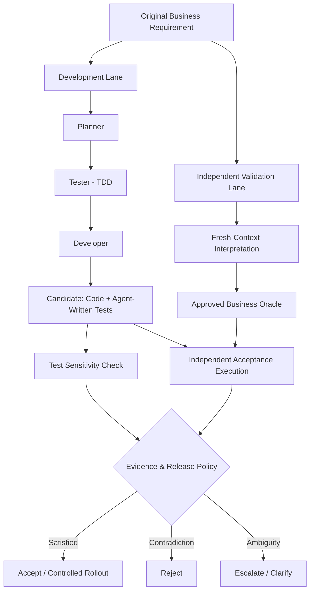

*When all AI agents agree on an error, who verifies the truth?*

> You have fully automated the software development process at a B2B SaaS company using AI agents. Your agent workflow consists of Planner, Product Owner, Developer, Tester, QA, and DevOps roles.
The system follows a TDD (Test-Driven Development) approach. The Planner defines tasks, the Tester writes tests first, the Developer implements, QA verifies, and DevOps deploys to production.
Everything looks perfect: unit tests pass, code coverage is 98%, the CI/CD pipeline is green. Human intervention is at a minimum.
However, two weeks after going to production, you discover that a critical business rule has been applied incorrectly. Upon investigation, you find that the tests were also validating the same incorrect business rule.
More importantly, all agents use the same underlying LLM and feed off each other's outputs. A requirement correctly interpreted by the Planner was misunderstood by the Tester and turned into expected behavior, by the Developer into working code, and by QA into a success criterion.
In other words:
> - The Planner, powered by model A, defines the requirement: "Apply a 10% discount to orders above 100 TL."
> - The Tester, powered by model A, misinterprets this as "Apply a 10% discount to orders at or above 100 TL" and writes a TDD test:
> - Model A writes the code.
> - The Reviewer model A compares the code and test and says it is correct.
> 
> Question:
> Does the fact that all tests pass in this system actually prove the software works correctly, or does it prove that the agents have consistently agreed on the same flawed assumption?
> 
> Did we really produce correct software? Or did we have the same model validate a misunderstood requirement over and over, producing **a consistent error**?
> 1. Are the tests truly sensitive to code changes?
> 2. Do the tests represent the correct business requirement?
> 3. Do agents that approve each other truly constitute an independent verification mechanism?

> **Core thesis:** *Being multi-agent does not mean performing independent verification.*

---

## System Design Interview: Everything is green in production, but the result is wrong

Your system follows a TDD (Test-Driven Development) approach: the Planner defines tasks, the Tester writes tests first, the Developer builds the code, QA verifies, and DevOps deploys to production.

Two weeks later, you discover that a critical business rule has been implemented incorrectly. During investigation, something even more striking emerges: **the tests were also validating the same incorrect business rule.**

Let's simplify the example.

**Original requirement:**

> A 10% discount shall be applied to orders above 100 TL.

The requirement clearly means *excluding 100 TL*. The expected condition is `amount > 100`.

However, the Tester agent interprets this as "at or above 100 TL." The Developer applies the same boundary. The flawed candidate in the Gateway demo tests this exact expectation in subunits (kuruş).

```js
assert.equal(calculateTotal(10000), 9000);
```

Because the flawed implementation uses `>= 10000`, this test passes. QA sees that the code and the test expect the same result. Test green. Review positive. Pipeline successful. [Demo candidate and tests](https://github.com/onurozkir/oracle-gateway/blob/main/tests/fixture.ts)

But the business rule is violated.

| Order amount | Actually expected | Flawed implementation |
|---:|---:|---:|
| 99 TL | 99 TL | 99 TL |
| **100 TL** | **100 TL** | **90 TL** |
| 101 TL | 90.90 TL | 90.90 TL |

This small boundary error could affect thousands of orders in a real pricing system.

Note: the problem here is not that tests were never written or never run. **The problem is that the expectation being tested was wrong.**

> **The problem is not that our tests failed. The problem is that our tests successfully verified the wrong behavior.**

Moreover, this example was chosen specifically to reduce the issue to just the `>=` vs `>` operators. In real systems, the same kind of error can surface in requirements that are far harder to interpret, such as which line items a discount applies to, role-based authorization, tenant isolation, refund conditions, or data retention policies.

The demo carries monetary values as integers in subunits (kuruş). It performs percentage calculations with `BigInt` and rounds the result to the nearest subunit. In the exact 100 TL case, the real difference is which branch is selected before rounding even begins.

## The name of the problem: Internal consistency is not correctness

This type of error is associated with three concepts.

**Common-mode failure:** Multiple components are affected by a shared error source. The Tester's incorrect interpretation carries into the Developer's implementation and QA's evaluation.

**Correlated errors:** The agents' errors are not independent of each other. The same underlying model, the same conversation history, or the same intermediate outputs can increase error correlation.

**Test oracle problem:** From which reliable source do we know that the expected result of a test is correct?

There is a critical nuance here: using the same LLM does not mean all agents will necessarily make the same mistake. Different LLMs can also arrive at the same incorrect interpretation. The issue is not just model identity; **it is how the information flow, assumptions, and approval authority are designed.**

A Tester producing the assumption `100 >= 100` is one event. The Developer accepting this assumption as correct is a second event. The Reviewer comparing only the code and the test without going back to the original requirement and saying "correct" is a third event.

Calling these three roles by different agent names does not produce three independent pieces of evidence.

---

## Three problems we must not conflate

### 1. Test Sensitivity — Can the tests actually catch errors?

The first question is whether the tests are sensitive to changes in code behavior.

If a test passes under every condition, does not directly exercise the production code, or cannot observe real behavior due to excessive mocking, it is not a reliable check.

We can approach this question with **mutation testing** and **negative control** techniques.

Mutation testing introduces controlled changes to the code and examines whether the tests catch them. In the negative control approach, for example, the newly written tests are kept while the implementation change is reverted: if the tests still pass, they may not have produced sufficient evidence against the change.

Here is the important boundary: a test **may be testing the wrong behavior very well.**

In our example, the test expecting `amount >= 100` might fail when the code is changed to `amount > 100`. This shows the test is sensitive — but it does not show that the test's expectation is correct.

Therefore:

> **Test sensitivity is not oracle correctness.**

### 2. Oracle Correctness — Is the expected behavior correct?

The second question is harder: where did the `expected` value in the test come from?

If the Tester generated it from their own interpretation and the Reviewer only referenced the assertion written by the Tester, there is no mechanism externally verifying the correctness of the work.

Such a system requires **an approved, implementation-independent business oracle.**

In the Gateway demo, the acceptance case `exact-threshold` is prepared separately from the candidate's test. It sends `{"amountCents":10000}` to the candidate and expects `{"totalCents":10000}`. Even if the candidate continues to expect 9000 in its own test, the oracle's expected value remains 10000. Maintaining this separation depends on **making the source of the expected result and the authority to change it visible.** [Acceptance cases](https://github.com/onurozkir/oracle-gateway/tree/main/tests/helpers.ts) · [Demo bundle](https://github.com/onurozkir/oracle-gateway/tree/main/tests/authority.ts)

An LLM can prepare this file. But if we automatically have the same LLM approve the file it prepared, we merely move the problem elsewhere.

For critical business rules, the oracle's source should be an approved product policy, a contract, a regulatory rule, a domain owner decision, or independently verified acceptance scenarios. Otherwise, all we have is a more neatly written assumption.

### 3. Verification Independence — Is the reviewer truly independent?

The third question concerns how the agent verifying the code obtains its information.

Consider what we provide to the Reviewer together:

- The Tester's incorrect assertion,
- The code written by the Developer according to that assertion,
- The Tester's "all tests passed" summary,
- The Developer's "task completed" statement.

Before the Reviewer even begins its evaluation, it is exposed to a context in which the same incorrect interpretation has been repeated multiple times.

My preferred approach is a two-phase evaluation:

**Phase 1 — Blind interpretation:** The Reviewer sees only the original requirement and authoritative sources. Without yet seeing the code or the Tester's expected result, it records the boundary conditions and expected behavior.

**Phase 2 — Candidate comparison:** The code and tests are revealed to the Reviewer. It compares the implementation against its own previously recorded expectations and reports semantic discrepancies with concrete examples.

This design reduces the direct carryover of the previous agent's reasoning to the reviewer. A different model family can also be used if desired.

However, it is important to emphasize:

> **Fresh context is not a guarantee of independent correctness. Using a different model alone is not a guarantee either.**

Two reviewers can arrive at the same incorrect interpretation. Therefore, especially for critical decisions, I would not substitute an independent model opinion **for approved oracles and executable evidence.**

---

## The architecture I propose: Independent Verification by Design

Here, instead of rewriting the development workflow from scratch, I would create two separate lanes: **Development Lane** and **Independent Validation Lane**.



Three technical decisions are defining in this diagram:

**One:** The Development Lane can produce its own tests, but it cannot unilaterally modify the approved business oracle.

**Two:** The Independent Validation Lane does not accept the Developer's tests as the starting authority. It proceeds from the original requirement and approved sources.

**Three:** The final release decision relies not on the agent's "I think it's correct" statement, but on recorded evidence and a deterministic policy.

### Step 1 — Version the requirement, don't freeze it

Business rules can change. What I actually need is the ability to **trace which code was verified against which version of the rule.**

In the Gateway's local task flow, `task start` takes an initial snapshot of the project files before editing and records the original request along with the contract draft. The user approves the contract's hash. When the agent changes the acceptance criterion, a new hash and a new approval are required. At the end of the task, `verify` takes a fresh snapshot. The report ties the result to this snapshot and shows which files were added, changed, or deleted. The explicit commit option answers the same question through Git. [Local task flow](https://github.com/onurozkir/oracle-gateway/tree/main/README.md#verify-a-local-task)

### Step 2 — Systematically generate boundary values

The requirement "above 100 TL" should not consist of a single happy-path test.

At a minimum, scenarios for 99, 100, and 101 TL should be tested. Where needed, more general invariants can also be checked with property-based testing and metamorphic testing.

In this rule, for example, the fact that no discount is applied at exactly 100 TL is, by itself, a strong counterexample.

### Step 3 — Separately stress-test the agent's tests

I would not remove the TDD tests. I would separately stress them with mutation testing or negative control.

The purpose of this layer is: *"Can these tests actually detect behavior changes?"*

I would not combine the answer to this question in the same metric as business correctness.

### Step 4 — Have the reviewer produce its interpretation first

The Reviewer should not interpret the requirement after seeing the code. It should first record its own expected scenarios; then evaluate the code.

If the Reviewer says `amount > 100` while the Tester says `amount >= 100`, this is recorded as a **semantic disagreement**. The system does not hide the disagreement or automatically close it by majority vote.

If the disagreement can be resolved with the approved business rule, a correction is requested. If the rule itself is ambiguous, it is escalated to the domain owner.

I use this separation in two places in the Gateway. Before approval, the reviewer reads the original request, records its interpretation, and then sees the YAML draft. At the end of the task, a separate review starts in the same order, this time seeing the finalized candidate code. The reviewer can, for example, report the difference between `>` and `>=`. The boundary case result is obtained by actually running the candidate. [Reviewer flow](https://github.com/onurozkir/oracle-gateway/blob/main/docs/reviewers.md)

### Step 5 — Deterministic completion gate

For release, these three pieces of evidence must be kept separate:

| Signal | What it proves | What it does not prove alone |
|---|---|---|
| Test sensitivity | That the tests can detect the relevant behavior change | That the expected behavior is correct |
| Approved oracle checks | That the candidate conforms to the approved business examples | That it is correct in all possible cases |
| Independent review | That different interpretations and discrepancies have been evaluated | That the reviewer is error-free |

The local decision policy in the Gateway implements a portion of this idea. It checks that the evidence matches candidate and contract identifiers and is up to date. If an approved boundary case fails, it issues `REJECT`. If required independent review evidence is insufficient, it produces `INCONCLUSIVE`; if a required check had a run error, it produces `INFRASTRUCTURE_ERROR`. `ACCEPT` means that a specific candidate satisfies the defined policy. [Decision policy](https://github.com/onurozkir/oracle-gateway/blob/main/packages/core/src/policy.ts)

---

## What would I do if I discovered this error two weeks into production?

In a System Design Interview, drawing architecture is not enough. As the engineer responsible for production, my first priority is not developing a new framework — it is containing the customer impact.

**First, I stop the impact.** I disable the flawed discount rule with a feature flag or roll back to a safe version. I prevent further incorrect price calculations.

**Then, I identify affected transactions.** I determine which orders were miscalculated at the 100 TL boundary and coordinate the correction or refund process with finance and product teams.

**Next, I investigate the root cause.** Is the error solely in the `>=` operator, or is it in the fact that the Tester's incorrect interpretation was accepted by the Reviewer without question? How did an incorrect assertion become an approved success criterion? Why didn't the CI demand independent evidence on this?

**Finally, I make the counterexample permanent.** The `100 TL → 100 TL` scenario is added to the acceptance corpus, which is kept outside the agent's write authority. Other boundary values for the same error class are also investigated.

I would also not limit production monitoring to just HTTP 200, latency, and exception rates. In domains like pricing, authorization, or finance, independent business reconciliation is needed. A service that looks technically healthy may be making the wrong business decision on every request.

---

## Final question: Which risks does TDD protect us from, and which does it not?

I would not abandon TDD because of this. On the contrary, I would correctly position what problem TDD solves.

| Risk | TDD's contribution |
|---|---|
| Code drifting from the behavior defined in tests | Can provide strong protection |
| Regression of previously tested behaviors | Helps catch regressions |
| Uncontrolled implementation and late test writing | Supports test-first discipline |
| Test expectations based on incorrect business rules | Does not protect on its own |
| Agents sharing a common wrong assumption | Does not protect on its own |
| Reviewer accepting incorrect tests as correct | Does not protect on its own |
| Untested production behavior | Does not protect on its own |

We can separate this with two concepts:

- **Verification:** Did we develop the code according to the behavior we defined?
- **Validation:** Did we define the correct behavior in the first place?

TDD is extremely useful in the verification process. However, it does not automatically establish the correctness of the business requirement from which the tests originate.

> **TDD helps verify that the implementation follows the expected behavior. It does not independently establish that the expected behavior is correct.**

The problem is not that TDD is an inadequate technique; it is that TDD is being loaded with a responsibility it was not designed for.

---

## The project born from this problem: Independent Oracle Gateway

Everything I have described so far leads us to a more practical question:

*Instead of merely describing these trust boundaries as architectural principles, can we turn them into an executable verification tool that can be placed in front of existing coding agent workflows?*

**Independent Oracle Gateway** was born from this question. A TypeScript-based CLI, it implements the oracle step that can be added to existing coding agent flows. It runs both the candidate's own tests and separately prepared acceptance cases, writing both results into the same report.

### What happened in the first demo?

I ran two demos in the source repository using Node.js 24 and Git.

```sh
npm ci
npm run demo:wrong
npm run demo:correct
```

| Candidate and policy | Candidate's test | Oracle | Decision |
|---|---|---|---|
| `>= 10000`, local standard | PASS | FAIL. Expected 10000 but got 9000. | `REJECT` |
| `> 10000`, local standard | PASS | PASS | `ACCEPT` |
| `> 10000`, critical | PASS | PASS | `INCONCLUSIVE` |

The first row is the starting point of this article. The candidate correctly implements the behavior its own test expects. The same candidate fails the boundary case derived from the original business rule. The last row also demonstrates the assurance boundary. The critical policy requires protected execution and independent review evidence. Today's run is local and `UNPROTECTED`. Test sensitivity and production release approval are separate layers of the broader architecture described above. [Demo source](https://github.com/onurozkir/oracle-gateway/blob/main/scripts/demo.ts) · [Running and reports](https://github.com/onurozkir/oracle-gateway/blob/main/README.md#quick-start) · [Known limitations](https://github.com/onurozkir/oracle-gateway/blob/main/docs/known-limitations.md)

I see the same error class beyond monetary calculations. If the request "Write **Your order has been received** on the page" is transcribed into the contract as **Your order has been placed**, there is an interpretation error in the draft. If the contract is correct but the wrong text appears on screen, the error is in the implementation. Today's demo compares numerical results in subunits. Being able to test text, boolean, and list fields requires carrying this same separation into a general data protocol.

### How will we measure the product's value?

We cannot evaluate a verification tool solely by its own success report.

The repository contains a starting measurement of 42 synthetic cases. This suite, which tests the comparison logic on boundary, rounding, role access, and tenant isolation cases, does not produce data about real agent performance. To measure that, the same requirements need to be given to the following four approaches and the results compared. [Benchmark methodology](https://github.com/onurozkir/oracle-gateway/blob/main/docs/benchmark-methodology.md)

1. Single model: Code + test + self-review, shared context.
2. Same model: Separate roles and isolated context.
3. Different models: Independent reviewer, but same requirement source.
4. Approved oracle: Isolated reviewer + independent acceptance tests + policy gate.

Measurements should not be limited to how many errors are found. False alarm rate, undetected errors, need for human escalation, verification latency, and token/infrastructure cost should also be reported.

This way, we can answer the questions "How much does using a different model actually help?", "How much does context isolation contribute?", and "In which error classes does an approved oracle make a difference?" — not with assumptions, but with experiments.

---

## Conclusion: Consensus is not correctness

The lesson I take from this scenario is not that software developed with AI agents cannot be trusted. It is that trust cannot be established through role names or successful test screens.

A Planner may have correctly defined the requirement. A Tester may have misunderstood it. The Developer may have successfully passed the wrong test. And the Reviewer may have compared the code with the test and approved the same mistake.

Adding more agents alone is not enough to break this chain.

What we need is:

- Evidence that the tests can actually detect errors,
- Evidence that test expectations are based on approved business rules,
- A controlled evaluation ensuring the Reviewer is not merely repeating the assumptions of previous agents,
- And a mechanism tying all of this to a reliable release policy.

**The goal is not to ensure all agents agree. It is to prevent the system from accepting something as correct without independent evidence, even when all agents share the same wrong opinion.**

> **Consensus is not correctness. Passing tests are not proof of valid requirements. And multiple agents are not independent reviewers unless independence is designed into the system.**

I believe that the next maturity step in AI-native software engineering is not just agents that produce better code, but systems that correctly design *who can pass judgment on the produced code and based on what evidence.*

---

### References and project links

- [Harnessed — Independent QA for AI coding agents](https://github.com/tt-a1i/harnessed)
- [Stryker — Mutation testing](https://stryker-mutator.io/)
- [GitHub Spec Kit — Specification-driven development](https://github.com/github/spec-kit)
- [Independent Oracle Gateway — Setup, demo, and local task flow](https://github.com/onurozkir/oracle-gateway/blob/main/README.md)
